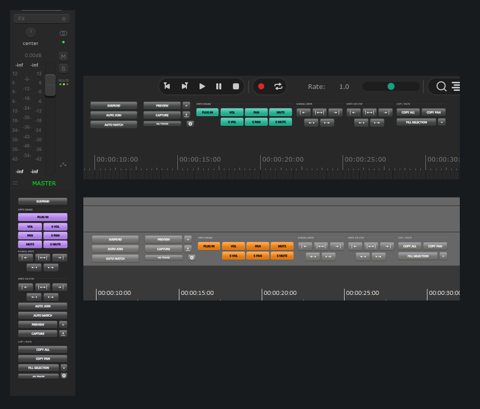
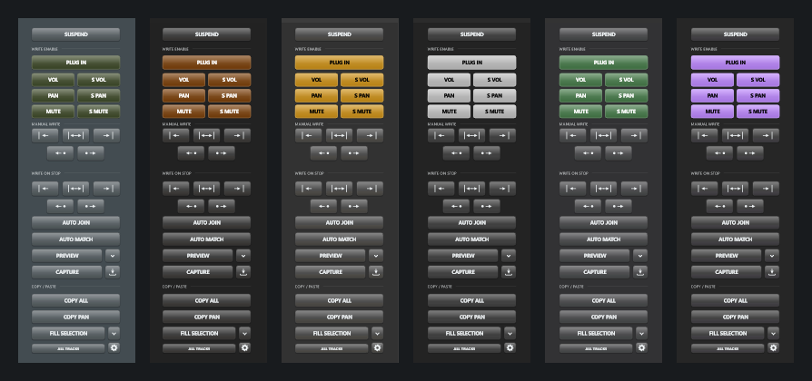
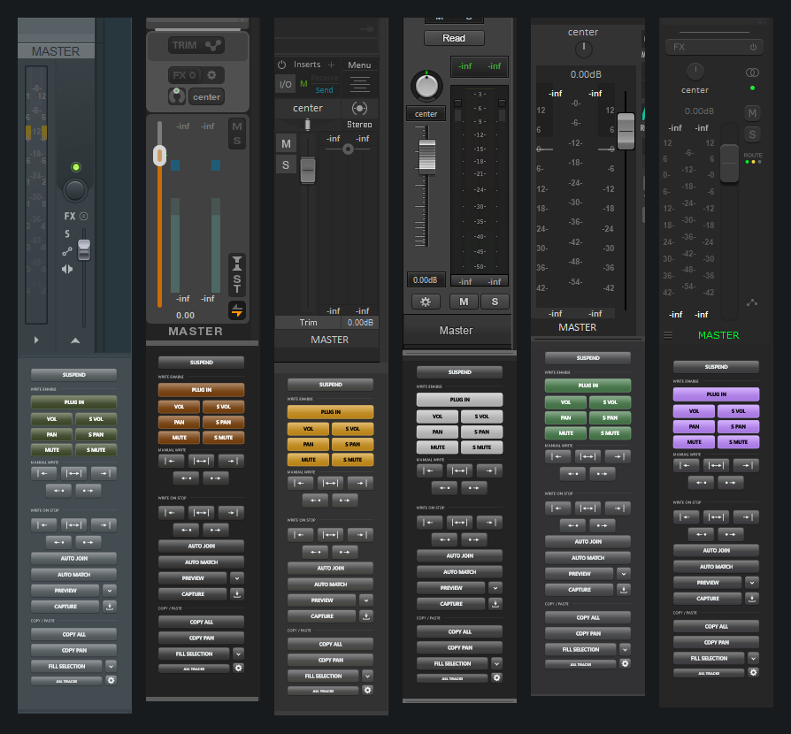

# EA Native Automation 2.2.4

A compact Pro Tools-inspired automation panel for REAPER, built for audio post-production. Native JUCE/C++ interface and REAPER integration, with a headless Lua automation engine. Created by Ebin Augustin while moving from Pro Tools to REAPER.

## Install through ReaPack

**Available binary: Windows 10/11 x64 and 64-bit REAPER.** macOS and Linux have source/build configurations only; installable binaries are not available yet.

1. In REAPER, run **ReaPack: Import repositories** and paste:

   `https://raw.githubusercontent.com/Ebinaugustin/REAPER-audio-post-scripts/main/index.xml`
2. Open **ReaPack: Browse packages**, search **EA Native Automation**, select version **2.2.4**, choose **Install**, then **Apply**.
3. Restart REAPER. Open **Actions → Show action list** and run **EA: Native Automation (JUCE) - toggle panel**.

The package installs the DLL and matching Lua engine together. No separate JUCE, ReaImGui or Lua installation is required. If the older standalone automation panel runs at startup, turn that startup option off and close it before using the native panel. When upgrading a manual installation, ReaPack may ask to replace the existing files.

Search **EA: Automation** in the Main Actions list to assign your own shortcuts: all 88 individual actions are registered by the extension, alongside the panel toggle. Enable **Run at startup** in the panel menu to open it when REAPER starts.

## Controls

- Write Enable for plug-in parameters, volume, pan, mute and send volume/pan/mute. PAN also covers ReaSurround/ReaSurroundPan.
- Preview, Preview A/B suspension, Capture, punch, Auto Join and Auto Match; selected-track Capture has a blinking indicator.
- Five Manual Write ranges and five Write on Stop modes. Successful Manual Write exits Preview. Writing across the project without a time selection asks for confirmation.
- Suspend bypasses existing envelopes and restores their previous activation when released.
- Copy All / Copy Pan, paste at cursor, stretch to selection, and repeat/fill to selection. Ordinary envelope points are the default; automation items are optional.
- Cross-track parameter matching. Sends use existing routing: matching bus first, then send slot; missing parameters are reported.
- Selected/all-track scope and automation modes.
- Floating or docked panel with vertical, horizontal and shallow layouts; vector icons, rounded glass-style buttons and press feedback.
- Follow REAPER colours plus five additional panel styles; active controls follow the exposed REAPER theme accent. Auto sizing and 50–200% presets.
- Right-click settings, docking choices, startup preference and running version.

Full control details and modifier behaviour are in the [source README](v2.2.4/EA-Native-Automation-2.2.4-Source.zip). The [action reference](v2.2.4/EA_Native_Automation/ACTIONS.md) lists shortcut actions and stable IDs.

## Known issues / testing status

Track volume and ordinary track pan Manual Write have reported cases of cursor dips/two points instead of the expected selected-range write, and unexpected envelope-lane exposure. Recent hotfixes address these paths, but live REAPER confirmation remains pending. Please report reproducible failures, including the running version, Preview state, track scope and time selection. The engine can write `ManualWrite-diagnostics.txt` beside `engine.lua` when verification fails.

Automated host-model and Windows native checks are documented in [VALIDATION.md](v2.2.4/EA_Native_Automation/VALIDATION.md); they do not establish that every live host behaviour is verified. macOS/Linux builds and live host testing remain pending.

## Screenshots

Actual user captures showing Follow REAPER with different REAPER themes, left docking beneath Master, and shallow top docking. The different host-theme colours shown here are not six different built-in panel styles.

## Source and licence

[Complete corresponding source, build files and pinned offline dependencies](v2.2.4/EA-Native-Automation-2.2.4-Source.zip).

This extension is **AGPL-3.0-or-later**, including JUCE under its open-source licensing option. This package has its own [licence](v2.2.4/EA_Native_Automation/LICENSE.txt) and [third-party notices](v2.2.4/EA_Native_Automation/THIRD-PARTY-NOTICES.md); the repository's MIT licence for other tools does not apply to this extension. REAPER and Pro Tools are separate products and are not included.
